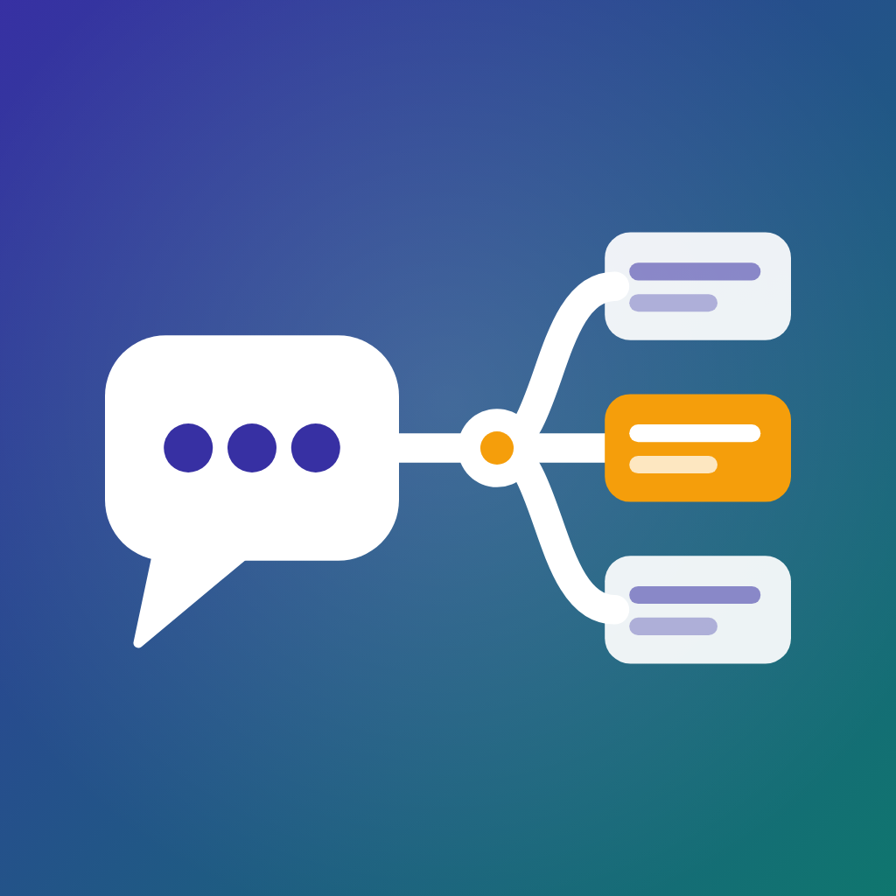

# Discord Thread Router



A Discord bot that watches chosen channels. When someone opens a thread there, the bot runs the actions you set for that channel and replies in the thread with a link to the result.

| Action | Result |
|---|---|
| `github_issue` | A GitHub issue |
| `github_discussion` | A GitHub discussion, in the category you name |
| `kanban_card` | A card on an [aa-kanban](https://github.com/mbroekman/aa-kanban) board |

A channel can have more than one action: a bug thread can become both a GitHub issue and a kanban card.

## Configuration

### 1. Secrets: `.env`

Copy `.env.example` to `.env`:

```env
DISCORD_TOKEN=...          # the bot's token
GITHUB_TOKEN=...           # for the GitHub actions
KANBAN_BASE_URL=https://auth.example.com/kanban/
KANBAN_API_KEY=...         # created in Django admin: AA Kanban > Intake API keys
RULES_FILE=rules.yaml      # optional; the container uses /app/config/rules.yaml
LOG_LEVEL=INFO             # optional
```

### 2. Channels: `rules.yaml`

All channels and their actions live in one file. Copy `rules.example.yaml` to `rules.yaml`, or to `config/rules.yaml` for the container:

```yaml
channels:
  "123456789012345678":          # #bugs (channel id; forum or text channel)
    - action: github_issue
      repo: mbroekman/aa-industry
      labels: [from-discord]     # optional
      title_prefix: "[Issue] "   # optional
    - action: kanban_card
      board: corp-tickets        # board slug
      list: Backlog              # optional; else the first list
      labels: [Discord]          # optional; existing labels only
      team: IT                   # optional; Kanban team name
      allow_bot_threads: false   # optional; true = also threads that a bot opens
  "987654321098765432":          # #suggestions
    - action: github_discussion
      repo: mbroekman/aa-industry
      category: Ideas            # optional; else the first category
```

- **Changes without a restart:** the bot rereads the file when it changes. If the new file is invalid, the bot logs the error and keeps the previous rules.
- **Channel id:** in Discord, turn on Developer Mode, then right-click the channel and choose "Copy Channel ID".
- **Old setup:** without `rules.yaml`, the bot falls back to the old `.env` keys (`FORUM_CHANNEL_ID`, `DISCUSSION_CHANNEL_ID`, `GITHUB_REPO_OWNER`, `GITHUB_REPO_NAME`).

### What the bot ignores

- Threads in channels without a rule.
- Threads opened by a bot. aa-kanban opens ticket threads itself, so this prevents a card → thread → card loop.
  - To act on a bot's threads anyway, set `allow_bot_threads: true` on the action. Example: the Authlink bot opens a private recruit thread with "@recruit is hunting for a recruiter!".
  - For such a thread, the first person the bot's message mentions becomes the author (the recruit), not the bot.
- The log says why a thread in a watched channel was skipped.
- A second event for the same thread. aa-kanban also returns the existing card instead of making a second one.

## Discord setup

In the [Discord Developer Portal](https://discord.com/developers/applications):

1. Turn on the **Message Content Intent**. The bot needs it to read the message that opens the thread.
2. Give the bot these permissions in the channels it watches:
   - `View Channel`
   - `Read Message History`
   - `Send Messages in Threads`

## Running it (Docker / Podman)

```bash
mkdir -p config && cp rules.example.yaml config/rules.yaml   # then edit it
podman-compose up -d --build      # or: docker compose up -d --build
podman logs -f github-discord-bot
```

The container restarts by itself (`restart: unless-stopped`). With rootless Podman, also run `loginctl enable-linger $USER` so it starts after a reboot without a login.

## Development

```bash
uv sync
uv run python -m thread_router   # run the bot locally
uv run pytest                    # tests (HTTP is mocked)
uv run ruff format . && uv run ruff check . && uv run mypy thread_router
```

### Adding an action

1. Write a class with a `name` and `async def handle(self, thread, options) -> Result` in `thread_router/actions/`.
2. Register it in `thread_router/actions/__init__.py`.

`handle` never raises: it returns `Result(ok=False, message=...)` and the bot reports that in the thread.
